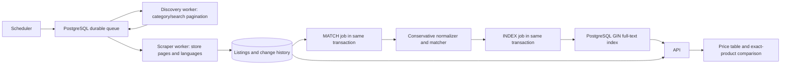

# Price-comparison pipeline



The API never crawls a store during a shopper request. The scheduler enqueues
due discovery and refresh jobs. A **separate Node process** consumes jobs. The
queue and search index use the existing PostgreSQL database; Redis and Meilisearch
are not required. The optional Meilisearch service in compose is unrelated to this
pipeline. PostgreSQL's SKIP LOCKED claims and GIN search index are actual durable
infrastructure, not in-memory simulations.

## Start locally

From the repository root, with `.env` configured:

```powershell
npm.cmd run db:generate
npm.cmd run db:migrate
npm.cmd run build --workspace=api
npm.cmd run pipeline:bootstrap --workspace=api
```

Bootstrap creates enabled Amazon iPhone-search and Almanea iPhone-category
discovery schedules if absent, preserving existing admin configuration. It queues
existing listings for matching and indexing. Before serving a newly migrated
installation, build the initial index:

```powershell
npm.cmd run worker --workspace=api -- --drain --kinds=MATCH,INDEX
```

Run these in **two terminals**, or under a service manager in production:

```powershell
npm.cmd run scheduler --workspace=api
npm.cmd run worker --workspace=api
```

On Windows, optional local background helpers are:

```powershell
powershell.exe -NoProfile -ExecutionPolicy Bypass -File scripts/start-comparison-pipeline.ps1
powershell.exe -NoProfile -ExecutionPolicy Bypass -File scripts/stop-comparison-pipeline.ps1
```

These launch a scheduler, a general worker, and an additional MATCH/INDEX-only
processor so fast search updates do not wait for a long scrape to finish. Logs
and PID records are under
`.local/comparison-pipeline/`. They are development helpers, not an automatic
restart service. Stopping a worker forcibly leaves its active job recoverable
after lease expiry. For production, use your host's process manager to restart
the scheduler/worker after reboot and crashes. Console SIGTERM/SIGINT shutdown
aborts scraping and records failed work for retry.

The API can alternatively host the lightweight scheduler when
`EXTERNAL_SYNC_ENABLED=true`; it still enqueues only, never scrapes. Running two
schedulers is safe: due-time updates and active-job deduplication are transactional.
Do not run the old import scripts as an additional cron scheduler.

## Scheduling and queue guarantees

- Polling: every 60 seconds. Discovery defaults to daily; tracked sources default
  to every six hours. Admin intervals must be at least an hour.
- Discovery follows Amazon's Next links to exhaustion and Almanea category page
  links, with a 100-page safety guard. Failure or incomplete parsing is reported;
  missing search results never imply product removal.
- Discovered URLs/ASINs are deduplicated against existing sources. New URLs are
  split into batches of 25 and queued for scraping automatically.
- A PostgreSQL row claim with `FOR UPDATE SKIP LOCKED` prevents two workers from
  owning a job concurrently. Active DISCOVER/SYNC jobs have unique deduplication
  keys. Atomic INSERT/ON CONFLICT handles simultaneous producers.
- Queue deadlines and throttle slots use timezone-aware columns, and the Prisma
  adapter explicitly opens UTC sessions. Changing the database server's default
  timezone does not shift queue backoff or host rate reservations.
- Jobs have 30-minute leases; discovery is bounded to fifteen minutes and sync to ten
  minutes. Source sync also has its own fifteen-minute lease. Stale owners cannot
  complete reclaimed jobs. Expired work is claimable by a replacement worker.
- Four attempts maximum, with 1/2/4-minute retry delays plus jitter. Exhausted jobs stay FAILED
  for inspection/retry. Temporary HTTP/network failures trigger retries. Permanent
  per-page parsing problems remain in PARTIAL run reports and are rechecked at
  the next periodic refresh, without retrying successful products rapidly.
- INDEX and MATCH jobs have priority so updated prices reach the website before
  the next long scrape begins. Queue delivery is at least once; handlers are
  idempotent and matching/index writes use per-listing advisory locks.
- Price writes and follow-up MATCH jobs commit atomically. MATCH updates and
  follow-up INDEX jobs also commit atomically. A process crash cannot silently
  lose the next stage.
- Shared database host throttling defaults to a 5?8 second request interval
  across worker processes. Robots crawl delays can raise this interval. HTTPS,
  domain allowlists, DNS checks, robots checks, bounded redirects, and response
  size limits still apply. No CAPTCHA/anti-bot bypass is attempted.
- Noon remains subject to live access restrictions; enabling a connector is not proof that a
  store permits access or exposes usable data.

## Matching policy

Automatic matches require an **explicit item condition** and one of:

1. A checksum-valid, normalized GTIN plus condition.
2. An exact brand and manufacturer part number plus condition.
3. A complete iPhone model/variant, storage, color, explicit region, and condition.

New, refurbished, used, and box-damaged offers are separate identities. Missing
attributes stay `NEEDS_REVIEW`; similar titles alone are never evidence of an
exact match. GTIN takes precedence over MPN, which takes precedence over title
attributes; missing identifiers can produce separate groups requiring review.
The title-based fallback currently supports iPhones. Other product categories
need reliable GTIN/MPN data or an admin-reviewed match. Metadata already collected
before this pipeline is refreshed on subsequent scrape jobs.

Admin overrides require a target product and a written reason. They are audited
in listing change history and remain manual through future refreshes. Matching is
not catalog publication and never changes seller inventory.

The price table exposes “Compare this exact product” for matched offers and a
variant-unverified note for other listings. `/en/compare/:id` and `/ar/compare/:id`
show only offers linked to that comparison identity.

## Search

`ExternalSearchDocument.tokens` is indexed with a PostgreSQL GIN index using the
`simple` text-search configuration, with bilingual token normalization. Searches
use the index to identify matches, then join current listing state and price for
ordering and pagination. Removed/excluded listings cannot leak through a stale
index. Page size is 20 and ties use listing ID for stable ordering. Index updates
are eventual; PostgreSQL listings remain the authoritative price source.

Titles and links still come from each store's actual English/Arabic pages. The
normalizer generates search tokens and identity attributes, never product titles.
Search supports terms/tokens, not arbitrary substring matching or typo tolerance.

## Admin operations

All routes below require ADMIN authentication under `/admin/external-pipeline`:

| Method/path                    | Purpose                                                        |
| ------------------------------ | -------------------------------------------------------------- |
| `GET /status`                  | Queue counts, indexed/matched/review counts, discovery health  |
| `GET /jobs`                    | Last 100 jobs and errors                                       |
| `POST /jobs/:id/retry`         | Retry an exhausted job                                         |
| `POST /schedule`               | Enqueue due work now                                           |
| `GET /discoveries`             | List discovery configurations                                  |
| `POST /discoveries`            | Create disabled config: name, store, startUrl, intervalMinutes |
| `PUT /discoveries/:id/enabled` | Enable/disable with `{"enabled":true}`                         |
| `POST /discoveries/:id/run`    | Queue one manual discovery                                     |
| `POST /reindex`                | Queue matching/index repair of all tracked listings            |
| `GET /review`                  | Last 100 active listings requiring match review                |
| `GET /products`                | Last 100 comparison identities                                 |
| `PUT /listings/:id/match`      | Manual mapping: productId, reason                              |

`POST /admin/external-sources/:id/sync` now **returns a queued job**, not the
completed run. Inspect job and run endpoints for completion. Discovery/source
configuration is persisted; process restarts do not reset schedules or jobs.

## Verification

```powershell
npm.cmd test --workspace=api -- --run src/external-sync
node scripts/test-comparison-pipeline.cjs
```

The second command runs against the configured database with temporary unique
fixture rows and cleans up its own records. It checks real competing queue claims,
deduplication, retries, stale leases, dead-letter handling, cross-store matching,
condition isolation, removal propagation, indexed sorting and the actual GIN index.
Run it before starting workers to avoid fixture work being consumed concurrently.

## Conservative periodic access

Discovery/refresh intervals receive up to 15% extra jitter (capped at one hour),
never an earlier run. Per-host request reservations include robots and redirects.
The default budgets are 120 requests/hour and 1,000 requests/day, shared by workers
and diagnostic import scripts. Override the documented EXTERNAL_CRAWL_* settings
in .env to meet an agreed store limit. Budget exhaustion defers work, not prices:
last known listings and observation timestamps remain available.

HTTP 429 pauses the whole store for at least one hour; 403 and CAPTCHA/access
challenges pause it for at least 24 hours; HTTP 5xx starts with a 15-minute pause.
Repeated failures increase the pause, capped at seven days for the local backoff.
A valid Retry-After header is always a lower bound even when it requests longer.
Both numeric seconds and HTTP-date forms are honored. Other workers recheck shared
cooldowns immediately before fetching. Scheduler ticks defer paused/exhausted
hosts, and pending jobs carry their retry deadline through failed run reports.
Passive cooldown/budget deferrals do not consume the job's four error attempts.
The admin status endpoint includes cooldowns, reasons, block counts and budgets.

Alternate-language pages are rechecked at most daily unless the original title
changes, including daily retries of missing localized titles. Price and stock
checks continue independently at the configured refresh interval.

These measures reduce unnecessary traffic and respect store feedback; no crawler
can guarantee it will never be blocked. No proxy rotation, deceptive user-agent
rotation, CAPTCHA solving, or access-control bypass is implemented. Prefer an
approved feed/API where the store cannot support public-page monitoring.

# Searching beyond iPhones

The Compare prices view accepts any product search. It posts the query to
`/catalog/external-prices/discover`, which creates independent daily Amazon, Almanea, and Noon search discoveries and
queues their first runs. A store cooldown or scheduling failure does not prevent
the other store from collecting. The response and UI report each store separately. Existing schedules are reused without forcing another
crawl or re-enabling an administrator-disabled search. Queries are normalized
for case, Unicode and repeated spaces. Public admission is capped at 10 new
searches per rolling 24 hours and 100 retained search schedules per store.
Administrators can manage these through the existing discoveries endpoints.

Workers follow pagination and retain all existing host budgets, backoff and
robots checks. The page checks for new saved results every 15 seconds for two
minutes, with a manual refresh button thereafter. Collection can take longer
when the queue is busy or a store has a cooldown. No result is guaranteed.
Almanea also supports configured category URLs. On-demand Almanea searches read
the first result batch embedded in its public search page (currently up to 32
products); later pages are client-side only, so this is not complete store coverage.
Only those result URLs are queued, and prices are verified on product pages.
Verified empty searches complete without manufacturing results. Noon is wired into
automatic collection; its search discovery reads the first
result batch embedded in its Next.js `__NEXT_DATA__` (similar to Almanea).
The connector currently collects one embedded result batch rather than complete store coverage.
Live Noon collection has not been verified here because its public host timed out;
the worker continues to enforce robots rules, cooldowns, and request budgets.
Exact product
matching uses GTIN or brand/MPN with condition for general products; listings
without sufficient identity remain unverified rather than being merged.

## Noon search access

Noon robots.txt explicitly disallows `/*/search/`. Public search admission returns
`robots_disallowed` without creating schedules or queue jobs. The UI offers the
direct store search link. The Noon product parser remains available for permitted
product URLs; automatic discovery requires an authorized feed/API. Earlier
connector descriptions do not imply live search collection is permitted.

## eXtra

eXtra appears in store comparison with a direct query search link. Its robots
policy disallows search pages for our bot, so discovery reports `robots_disallowed`
and creates no search jobs. Administrators may configure `EXTRA` sources with
permitted product URLs or leaf product sitemaps. Product collection uses the
existing Product/Offer JSON-LD parser and `/en-sa/` and `/ar-sa/` title routes.
Robots checks and host budgets apply to every request. Live price parsing has
not yet been verified against an eXtra product page.

## Direct browser collection

Set `EXTERNAL_BROWSER_ENABLED=true` in the API and worker environment to use
Playwright Core with locally installed Chrome for Noon and eXtra searches and
product pages. Set `EXTERNAL_BROWSER_EXECUTABLE` if Chrome is not in a standard
location. Browser mode is enabled in the local development environment.

This explicit mode replaces the static search-admission restriction and HTTP
robots gate for those two stores, as requested for direct store searches. HTTP
mode retains its robots checks. Browser mode retains host budgets, request
spacing between page navigations, public-address checks, isolated sessions, a
400-subrequest limit per page, time limits, and
shared cooldowns for 403, 429, server errors, and challenges. It does not solve
CAPTCHAs or reuse personal browser cookies. Search extraction is limited to the
first 40 product links in the rendered result region; prices come from product
pages. Menu links and external URLs are excluded.

Live validation found eXtra search products and parsed a product price in SAR.
Noon navigation still timed out from this machine, including in Chrome.

### Noon browser retry

A repeat search and product-page check still failed during Chrome navigation.
An unmodified headless Chrome session also returned `ERR_HTTP2_PROTOCOL_ERROR`
with no product links, so live Noon parser compatibility remains unverified.
The adapter now reuses shared Product/Offer validation, checks SKU identity,
requires explicit currency, and excludes speculative base/current-price fields.
Fixture-tested embedded-page support remains available without claiming live
collection has succeeded.

## Trendyol

Trendyol uses the Saudi site (`www.trendyol.sa/en/sr?q=...`), not the global
`.com` site. Explicit direct-browser mode supports its product-card search
region, up to 40 results, and standard Product/Offer JSON-LD product prices.
Seller selection (`merchantId`) is retained in URLs and discovery identities;
promotional/membership-only prices are not substituted for the standard offer.
Its search robots policy is restrictive, so HTTP-mode public admission returns
`robots_disallowed`. It uses the already configured explicit browser mode.
Live Chrome validation discovered headphone products; structured product
prices returned SAR. English/Arabic title routes preserve seller selection.

## Natural-language lowest-price searches

Search accepts phrases such as `the lowest iphone 17 price`,
`cheapest refurbished iPhone 17 Pro Max 256GB`, and `أرخص آيفون 17`.
A conservative phrase parser removes price-intent and leading request words
while preserving the product, model, storage, condition, and accessory terms.
Plain product searches remain unchanged. An intent with no product requests
a product name rather than searching the whole catalog.

`GET /catalog/search-intent?q=...` returns the interpreted query and suggested
`price_asc` sort. The page keeps the original text in the form, explains the
interpretation, and sends product terms to catalog and direct-store
searches. Explicit catalog sort selections are preserved. External saved
prices already sort ascending. Catalog API searches and external index queries
also interpret the phrase, so direct API clients do not need to strip it.
This finds lowest matching saved prices; it does not establish the cheapest
price across every store or verify Google snippets.
